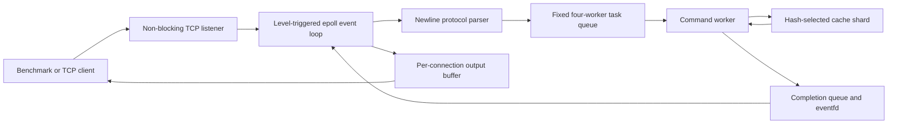

# Distributed Cache

A small Redis-inspired in-memory cache server written in C++17. The project is intended as an interview-preparation and systems-programming exercise: the cache, protocol parser, Linux TCP server, sharding, tests, and benchmark are implemented as separate, readable components.

## Features

- Fixed-capacity LRU cache using `std::unordered_map` and `std::list`.
- Optional TTLs measured with `std::chrono::steady_clock`.
- Lazy expiry during `get()` and a min-heap-backed `cleanup()` method.
- Configurable key-based sharding. Each shard owns its mutex, map, LRU list, and expiry heap.
- Linux TCP server using non-blocking sockets, level-triggered `epoll`, and a fixed four-thread command pool.
- Newline-delimited `SET`, `GET`, and `DEL` text protocol.
- GoogleTest unit tests and a concurrent CSV benchmark client.

## Project Layout

```text
.
|-- CMakeLists.txt
|-- include/
|   |-- lru_cache.h
|   |-- protocol_parser.h
|   `-- tcp_server.h
|-- src/
|   |-- lru_cache.cpp
|   |-- protocol_parser.cpp
|   |-- tcp_server.cpp
|   `-- tcp_server_main.cpp
|-- tests/
|   |-- lru_cache_test.cpp
|   `-- protocol_parser_test.cpp
`-- bench/
    |-- cache_bench.cpp
    `-- run_matrix.sh
```

## Architecture



### Cache and sharding

`LRUCache` routes every key to one shard using:

```text
std::hash(key) % shard_count
```

Each shard has its own mutex, hash map, LRU list, and TTL min-heap. `get`, `put`, and `erase` acquire only the lock for the key's shard. Cleanup and aggregate size inspection visit one shard at a time and release its lock before visiting the next. No operation holds two shard locks, which avoids cross-shard lock-order cycles and deadlocks.

Capacity is divided into fixed per-shard quotas whose sum equals the configured total. A shard evicts its own least-recently-used key when its quota is full. This is partitioned LRU, not one globally ordered LRU: one shard may evict an entry while another shard still has unused capacity. If there are more shards than capacity, some shards have a zero-entry quota. The constructor rejects a shard count of zero.

TTL deadlines use `steady_clock`, so wall-clock adjustments do not change expiry behavior. `get()` lazily removes a key whose deadline has passed. TTL entries are also recorded in a min-heap; `cleanup()` pops due records and checks that each record still matches the current entry deadline before erasing it. That check makes heap records left behind by updates, deletes, and reinserts harmless.

The cache API exposes `cleanup()`, but the current server does not run a periodic cleanup task. Expired entries are removed when accessed; applications embedding `LRUCache` can call `cleanup()` to reclaim idle expired entries proactively.

### Server and threading

The server is Linux-specific and is built only when CMake detects Linux. The listening socket and accepted client sockets are non-blocking. The event loop uses **level-triggered** epoll and drains reads until `EAGAIN`/`EWOULDBLOCK`. Each connection retains a parser remainder, pending commands, an output buffer, and an output offset so partial reads and writes are handled correctly.

The event loop owns socket state. It sends commands to a fixed pool of four workers; workers execute cache operations and publish results to a synchronized completion queue. An `eventfd` wakes epoll when a worker finishes. Each connection has at most one command in flight, preserving request/response order on that connection while different connections can make progress concurrently.

The server handles `SIGINT` and `SIGTERM` by waking the event loop. The worker pool drains queued work and joins its threads during shutdown. The cache capacity is currently fixed at 1,024 entries in the server executable; the shard count is configurable on the command line.

## Requirements

- Linux (or Windows with WSL2 and an Ubuntu distribution)
- C++17 compiler such as GCC or Clang
- CMake 3.16 or later
- POSIX threads
- GoogleTest for unit tests

On Ubuntu/WSL, install build dependencies with:

```bash
sudo apt update
sudo apt install build-essential cmake libgtest-dev
```

## Build and Test

From the project root:

```bash
cmake -S . -B build -DCMAKE_BUILD_TYPE=Debug
cmake --build build -j
ctest --test-dir build --output-on-failure
```

The server and benchmark targets are available on Linux. GoogleTest is required by the default `BUILD_TESTING` configuration.

### Sanitizers

ThreadSanitizer is available through the project option:

```bash
cmake -S . -B build-tsan \
  -DCMAKE_BUILD_TYPE=Debug \
  -DCACHE_ENABLE_TSAN=ON
cmake --build build-tsan -j
ctest --test-dir build-tsan --output-on-failure
```

For AddressSanitizer with GCC or Clang:

```bash
cmake -S . -B build-asan \
  -DCMAKE_BUILD_TYPE=Debug \
  -DCMAKE_CXX_FLAGS="-fsanitize=address -fno-omit-frame-pointer -g" \
  -DCMAKE_EXE_LINKER_FLAGS="-fsanitize=address"
cmake --build build-asan -j
ctest --test-dir build-asan --output-on-failure
```

## Run the Server

```bash
./build/cache_server [port] [shard_count]
```

Defaults are port `6379` and 16 shards. For example, to run the one-shard baseline:

```bash
./build/cache_server 6379 1
```

Stop the server with `Ctrl+C` or `SIGTERM`.

## Text Protocol

Commands are newline-terminated. `SET` keys and values are whitespace-delimited, so keys and values cannot contain spaces or newlines.

```text
SET key value
SET key value ttl_seconds
GET key
DEL key
```

TTL is an optional non-negative integer number of seconds. Responses are also newline-terminated:

| Request outcome | Response |
| --- | --- |
| Successful `SET` | `OK` |
| `GET` hit | The stored value |
| `GET` miss or unsuccessful `DEL` | `NOT_FOUND` |
| Successful `DEL` | `OK` |
| Invalid command or arguments | `ERR <message>` |

Example session:

```text
SET color blue 30
OK
GET color
blue
DEL color
OK
GET color
NOT_FOUND
```

The parser is independent of networking. It accepts a byte buffer, returns every complete command/error in order, and returns an incomplete trailing command as a remainder for the next read.

## Benchmark

`cache_bench` opens the requested number of persistent client connections, preloads a key range outside the timed interval, waits until all clients are ready, then sends a configurable random GET/SET mix. Each connection has one request in flight at a time; latency is the request/response round trip. The program prints a CSV header and one result row. Latencies are nearest-rank percentiles in microseconds; throughput is total completed operations divided by timed wall-clock duration.

```bash
./build/cache_bench \
  <host> <port> <clients> <ops_per_client> <get_percent> \
  <key_count> <shards> [seed]
```

Example:

```bash
./build/cache_bench 127.0.0.1 6379 32 1000 80 512 16 17
```

CSV columns:

```text
shards,clients,ops_per_client,total_ops,gets,sets,ops_per_sec,p50_us,p95_us,p99_us
```

To run the requested 1-versus-16-shard comparison at 1, 8, 32, and 128 clients:

```bash
OPS_PER_CLIENT=1000 bash bench/run_matrix.sh build
```

The script starts and stops its own local servers. Optional environment variables are `OPS_PER_CLIENT` (default `2000`), `GET_PERCENT` (default `80`), `KEY_COUNT` (default `512`), `BASE_PORT` (default `16420`), and `SEED` (default `17`). Pass a different build directory as the script's first argument if needed. Make sure the selected base ports are available.

Benchmark results depend on hardware, operating-system scheduling, compiler flags, and background load. Run multiple trials on an otherwise idle Linux system and compare medians before drawing conclusions. With the current four-worker pool, the worker count is another throughput limit independent of the shard count.

## Tests

The GoogleTest suites cover:

- LRU eviction order, update recency, and capacity-one behavior
- Lazy expiry, heap cleanup, stale TTL records, and multi-shard cleanup
- Shard capacity quotas and concurrent cache access
- Split protocol buffers, pipelined commands, parse errors, TTL validation, and response formatting

## Design Trade-offs

- `std::list` keeps iterators stable and makes LRU promotion easy with `splice`; its nodes have allocation and pointer overhead.
- Fixed shard quotas preserve the configured total capacity but can leave unused capacity in one shard while another is full.
- A single worker pool keeps thread count bounded, but the current size is fixed at four workers.
- One command in flight per connection makes response association simple but does not measure pipelined throughput.
- The implementation is an educational in-memory server: it has no persistence, authentication, encryption, or binary-safe values.